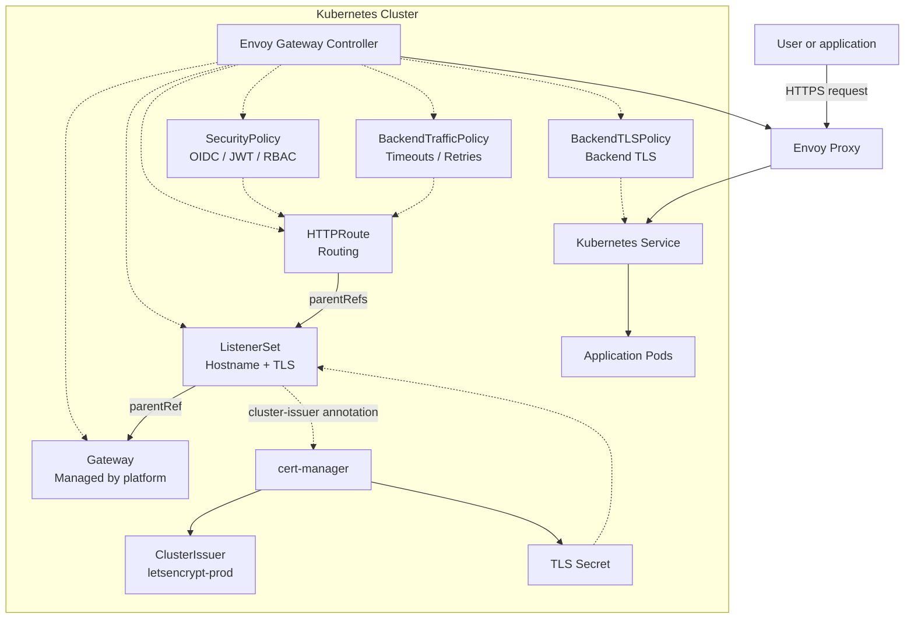
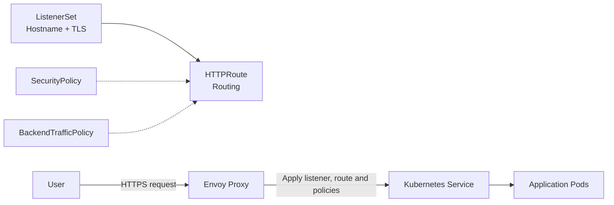

# Exposing applications with Gateway API

Applications are exposed through Envoy Gateway using Kubernetes Gateway API resources.

Gateway API separates routing, security, and traffic management into dedicated resources.

## Main resources

| Resource | Purpose |
|---|---|
| `ListenerSet` | Expose a hostname and configure HTTPS |
| `HTTPRoute` | Route requests to a Kubernetes Service |
| `SecurityPolicy` | Configure authentication and authorization |
| `BackendTrafficPolicy` | Configure timeouts, retries and traffic behaviour |
| `BackendTLSPolicy` | Configure TLS between Envoy Proxy and backend services |
| `cert-manager` | Automatically issue and renew TLS certificates |

Useful references:

- https://gateway-api.sigs.k8s.io/
- https://gateway.envoyproxy.io/
- [cert-manager Documentation](https://cert-manager.io/docs/)

## Architecture

The Envoy Gateway controller watches Gateway API resources and configures the Envoy Proxy accordingly.

The shared `Gateway` is managed by the platform team. Application developers typically create a `ListenerSet`, an `HTTPRoute`, and optional policies.

```text
Gateway (platform-managed)
└── ListenerSet
    └── HTTPRoute
        └── Service
            └── Pods
```



## Request flow

The following diagram shows how a request is processed.



## Exposing an application over HTTPS

A typical application exposure requires:

1. A `ListenerSet`
2. An `HTTPRoute`

TLS certificates are automatically issued and renewed by cert-manager when the `ListenerSet` contains the following annotation:

```yaml
cert-manager.io/cluster-issuer: letsencrypt-prod
```

No `Certificate` resource needs to be created manually.

### ListenerSet

The `ListenerSet` attaches your application to the shared platform `Gateway`.

```yaml
apiVersion: gateway.envoyproxy.io/v1alpha1
kind: ListenerSet
metadata:
  name: demo-listeners
  annotations:
    cert-manager.io/cluster-issuer: letsencrypt-prod
spec:
  parentRef:
    group: gateway.networking.k8s.io
    kind: Gateway
    name: shared-gateway
    namespace: envoy-gateway-system

  listeners:
    - name: demo-https
      hostname: demo.example.com
      port: 443
      protocol: HTTPS
      tls:
        mode: Terminate
        certificateRefs:
          - name: demo-example-com-tls
```

### HTTPRoute

```yaml
apiVersion: gateway.networking.k8s.io/v1
kind: HTTPRoute
metadata:
  name: demo
spec:
  parentRefs:
    - name: demo-listeners
      kind: ListenerSet
      group: gateway.envoyproxy.io

  hostnames:
    - demo.example.com

  rules:
    - matches:
        - path:
            type: PathPrefix
            value: /

      backendRefs:
        - name: demo
          port: 80
```

With these resources:

- `demo.example.com` is exposed over HTTPS.
- TLS certificates are automatically managed by cert-manager.
- The `ListenerSet` attaches to the shared `Gateway`.
- The `HTTPRoute` attaches to the `ListenerSet`.
- Requests are routed to the `demo` Service on port `80`.

Replace the example values with those appropriate for your application.

## Securing an application

Use a `SecurityPolicy` to configure:

- OpenID Connect (OIDC)
- Keycloak integration
- JWT validation
- Role-based access control (RBAC)

## Configuring backend traffic

Use a `BackendTrafficPolicy` to configure:

- Request timeouts
- Retries
- Load balancing
- Circuit breaking

Use a `BackendTLSPolicy` when communication between Envoy Proxy and the backend service must use TLS.

## From Ingress to Gateway API

Applications were previously exposed using:

- Ingress
- NGINX Ingress Controller
- cert-manager

Applications are now exposed using:

- Gateway
- ListenerSet
- HTTPRoute
- Envoy Gateway
- SecurityPolicy
- BackendTrafficPolicy
- BackendTLSPolicy
- cert-manager

This architecture separates routing, security, TLS management, and traffic policies into dedicated resources.