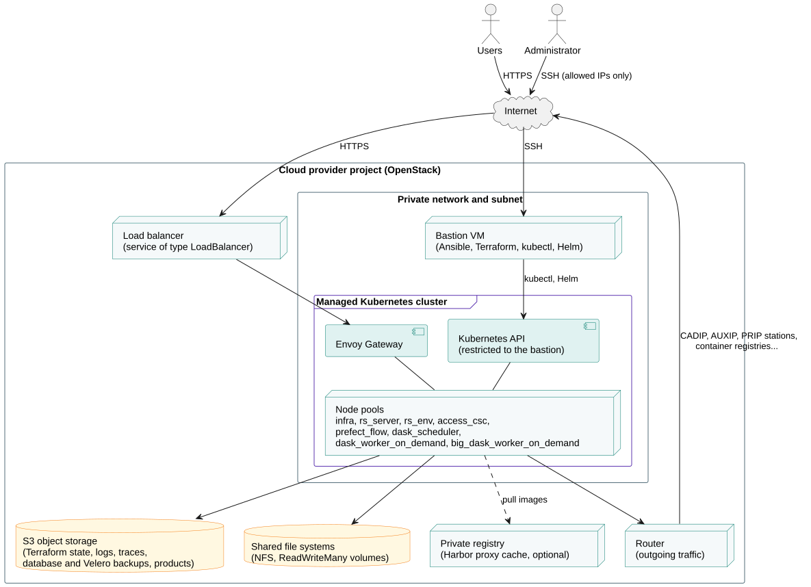

# Infrastructure installation

This guide creates the Kubernetes cluster of an RS-Python platform and deploys the core infrastructure on it. It is
the first step of the [deployment of RS-Python](https://github.com/RS-PYTHON/rs-documentation/blob/develop/docs/administration/deploy.md),
that also describes the deployment mechanism (packages of applications, inventory, `apps.yaml` playbook) and the
next steps.

## Overview

The infrastructure is created with [Terraform](https://developer.hashicorp.com/terraform) on an
[OpenStack](https://www.openstack.org/)-based public cloud (the Terraform code of `roles/terraform` targets
[OVHcloud](https://www.ovhcloud.com/en/public-cloud/)), then configured with [Ansible](https://docs.ansible.com/):



| Resource | Description |
|---|---|
| Private network | A private network, subnet and router. The router gives the outgoing Internet access to the cluster nodes, e.g. to reach the stations and the container registries. |
| Bastion | A virtual machine, reachable with SSH from a list of allowed IP addresses only (`allowed_ip_list`), used by the administrators to deploy and operate the platform. The Kubernetes API is only reachable from the bastion (or with [remote kubectl](how-to/remote-kubectl.md) through Keycloak). |
| Kubernetes cluster | A managed Kubernetes cluster, with one node pool per kind of workload (see [node pools](https://github.com/RS-PYTHON/rs-documentation/blob/develop/docs/administration/deploy.md#deployment-steps)), each one with its size and autoscaling settings. |
| Load balancer | Created by Kubernetes for the [Envoy Gateway](https://gateway.envoyproxy.io/) service: the single entry point of all the web services, in HTTPS. |
| Object storage | S3 buckets for the Terraform state, the logs (Loki), the traces (Tempo), the database backups and the Velero backups. The buckets of the products are configured in [rs-server-deployment](https://github.com/RS-PYTHON/rs-server-deployment). |
| Shared file systems | [OpenStack Manila](https://docs.openstack.org/manila/latest/) NFS shares, for the `ReadWriteMany` volumes, see [Enable ReadWriteMany volumes](how-to/readwritemany-volume.md). |
| Private registry (optional) | A [Harbor](https://goharbor.io/) registry used as a proxy cache of the public container registries. |

The core applications deployed on the cluster by this repository are in the [apps](https://github.com/RS-PYTHON/rs-infra-core/tree/develop/apps) folder:

| Applications | Role |
|---|---|
| `00-crds-*` | The Kubernetes custom resource definitions of the operators. |
| `00-namespaces`, `00-storage-class`, `00-secret-private-registry` | The namespaces, storage classes and container registry credentials. |
| `01-cert-manager`, `02-cluster-issuer` | [cert-manager](https://cert-manager.io/), that creates the TLS certificates with [Let's Encrypt](https://letsencrypt.org/). |
| `01-csi-driver-nfs`, `01-openstack-manila-csi` | The CSI drivers for the shared file systems. |
| `02-envoy-gateway`, `03-listenersets` | [Envoy Gateway](https://gateway.envoyproxy.io/), the implementation of the Kubernetes [Gateway API](https://gateway-api.sigs.k8s.io/), see [Exposing applications with Gateway API](how-to/gateway-api-httproute.md). |
| `02-plugin-cloudnative-pg`, `03-cloudnative-pg` | [CloudNativePG](https://cloudnative-pg.io/), the PostgreSQL operator used by all the databases, with their backups in the object storage, see [Restore a database](how-to/restore-database-cloudnativepg.md). |
| `03-keycloak-operator`, `04-keycloak-db`, `05-keycloak` | [Keycloak](https://www.keycloak.org/), the identity and access management, with its database and its realm, see [Keycloak realm export and import](how-to/keycloak-realm-export-import.md). |
| `04-kubectl-oidc` | The OpenID Connect authentication of `kubectl` with Keycloak, see [Remote kubectl](how-to/remote-kubectl.md). |
| `02-ds-fanotify` | A daemon set that raises the `fanotify` limits of the nodes. |
| `velero` | [Velero](https://velero.io/), the backup and restore of the Kubernetes resources and volumes, see [Velero backup and restore](how-to/velero-backup-restore.md). |

The security components (intrusion detection, container security) are deployed on top of this infrastructure from a
non-public repository.

## Requirements

The installation is run from an administrator machine, then from the bastion. It needs:

- [git](https://git-scm.com/) and [jq](https://jqlang.org/),
- [Miniforge](https://github.com/conda-forge/miniforge), to install the other tools:
  [Ansible](https://docs.ansible.com/), [Terraform](https://developer.hashicorp.com/terraform),
  the [OpenStack CLI](https://docs.openstack.org/python-openstackclient/latest/), [Helm](https://helm.sh/) and
  [kubectl](https://kubernetes.io/docs/reference/kubectl/),
- an account on the cloud provider, with its OpenStack credentials (`openrc.sh` file) and its API credentials,
- an S3 bucket for the Terraform state,
- a domain name, whose DNS records you can edit,
- optionally, a [HashiCorp Vault](https://developer.hashicorp.com/vault) instance to store the credentials, see
  [Credentials management](how-to/credentials.md).

## Installation

### 1. Get the rs-infra-core repository

```shell
git clone https://github.com/RS-PYTHON/rs-infra-core.git
cd rs-infra-core
```

### 2. Install the tools

```shell
# Install Miniforge
mkdir -p ~/miniforge3
wget "https://github.com/conda-forge/miniforge/releases/latest/download/Miniforge3-$(uname)-$(uname -m).sh" -O ~/miniforge3/miniforge.sh
bash ~/miniforge3/miniforge.sh -b -u -p ~/miniforge3
rm -f ~/miniforge3/miniforge.sh

# Initialise conda for your shell (bash or zsh)
~/miniforge3/bin/conda init bash

# Create the "rspy" environment with a recent Python version and activate it
conda create -y -n rspy python=3.13
conda activate rspy

# Install Ansible, Terraform, the OpenStack CLI, Helm, kubectl and their Python dependencies
conda install -y -c conda-forge "ansible<12" terraform python-openstackclient passlib boto3 kubernetes-helm kubernetes-client python-kubernetes
ansible-galaxy collection install kubernetes.core openstack.cloud amazon.aws
```

### 3. Create your inventory

The inventory contains the configuration and the credentials of your platform. Create it from the sample inventory,
and keep it in a private place (private repository, secret manager...):

```shell
cp -rfp inventory/sample inventory/mycluster
cp -rfp inventory/mycluster/.env.template inventory/mycluster/.env
cp -rfp inventory/mycluster/openrc.sh.template inventory/mycluster/openrc.sh
```

Then edit its files:

| File | Content |
|---|---|
| `.env` | The API credentials of the cloud provider, and the credentials of the S3 bucket of the Terraform state. |
| `openrc.sh` | The OpenStack credentials and region. |
| `backend.tfvars` | The S3 bucket of the Terraform state. |
| `cluster.tfvars` | The cluster name and region, the IP addresses allowed to reach the bastion (`allowed_ip_list`), the size and autoscaling of the node pools, the buckets to create, and optionally a Docker Hub account. |
| `hosts.yaml` | The path of the Python interpreter of the `rspy` conda environment (`ansible_python_interpreter`). |
| `host_vars/setup/main.yaml` | The domain name, the cluster name, the certificate issuer, the S3 endpoint and credentials, the optional HashiCorp Vault. |
| `host_vars/setup/apps.yml` | The parameters of all the applications of all the repositories: namespaces, sub-domains, versions, resources, credentials... |

The parameters of `host_vars/setup/apps.yml` are templated by the `generate_inventory.yaml` playbook, that generates
the random credentials once for all, see [Credentials management](how-to/credentials.md). To change the parameters
of a running platform, see
[Update the infrastructure](https://github.com/RS-PYTHON/rs-documentation/blob/develop/docs/administration/update-infrastructure.md).

### 4. Deploy the private registry (optional)

The private [Harbor](https://goharbor.io/) registry is a
[proxy cache](https://goharbor.io/docs/main/administration/configure-proxy-cache/) of the public container
registries, that avoids pulling the same images many times from them:

```shell
ansible-playbook registry.yaml -i inventory/mycluster/hosts.yaml
```

To use it, add `-e private_registry=true` to the `apps.yaml` commands below.

### 5. Generate the inventory

```shell
ansible-playbook generate_inventory.yaml -i inventory/mycluster/hosts.yaml
```

### 6. Create the cluster

```shell
ansible-playbook cluster.yaml -i inventory/mycluster/hosts.yaml
```

This playbook creates an SSH key (`inventory/mycluster/privatekey.pem`) if needed, the Terraform state bucket, then
all the cloud resources with Terraform, configures the shared file systems credentials, copies the working
directory (repository and inventory) and the kubeconfig file to the bastion, and installs the administration tools
on it (kubectl, Helm, Kustomize, yq...). See [Cluster management](how-to/cluster-management.md) to work with the Terraform state afterwards.

### 7. Deploy the core applications

Connect to the bastion and go to the `rs-infra-core` directory:

```shell
ssh -i inventory/mycluster/privatekey.pem ubuntu@<BASTION_IP>
cd ~/rs-infra-core
```

Deploy the applications of this repository:

```shell
ansible-playbook apps.yaml -i inventory/mycluster/hosts.yaml
```

Options of the `apps.yaml` playbook:

- `-e private_registry=true` to pull the images through the private registry (disabled by default),
- `-e app=<name>` to deploy a single application, e.g. `-e app=keycloak` for `05-keycloak`,
- `-e crd_wait_timeout=30` to change the wait timeout of the `CustomResourceDefinition` resources, in seconds,
- `-e job_wait_timeout=180` for the `Job` resources,
- `-e custom_wait_timeout=180` for the `Certificate`, `Cluster`, `ClusterIssuer`, `Keycloak` and
  `KeycloakRealmImport` resources,
- `-e native_wait_timeout=360` for the `Pod`, `Deployment`, `StatefulSet` and `DaemonSet` resources.

> **Note:** configure your domain name (and its sub-domains) to point to the external IP address of the Envoy
> Gateway load balancer:
> `kubectl -n envoy-gateway get svc -l app.kubernetes.io/component=proxy`.

### 8. Deploy the other layers

The other layers of RS-Python are deployed with the same `apps.yaml` playbook, from the bastion, with the
`package_paths` variable:

```shell
cd ~
git clone https://github.com/RS-PYTHON/rs-infra-monitoring.git
git clone https://github.com/RS-PYTHON/rs-workflow-env.git
git clone https://github.com/RS-PYTHON/rs-server-deployment.git
git clone https://github.com/RS-PYTHON/rs-workflow-deployment.git
cd ~/rs-infra-core

ansible-playbook apps.yaml -i inventory/mycluster/hosts.yaml -e '{"package_paths": ["~/rs-infra-monitoring/apps/"]}'
ansible-playbook apps.yaml -i inventory/mycluster/hosts.yaml -e '{"package_paths": ["~/rs-workflow-env/apps/"]}'
ansible-playbook apps.yaml -i inventory/mycluster/hosts.yaml -e '{"package_paths": ["~/rs-server-deployment/apps/"]}'
ansible-playbook apps.yaml -i inventory/mycluster/hosts.yaml -e '{"package_paths": ["~/rs-workflow-deployment/apps/"]}'
```

The order of the layers, and the actions to do between them, are described in
[Deploy RS-Python](https://github.com/RS-PYTHON/rs-documentation/blob/develop/docs/administration/deploy.md#deployment-steps).
In particular, after the deployment of [rs-workflow-env](https://github.com/RS-PYTHON/rs-workflow-env):

- the Dask clusters are authenticated with JupyterHub: generate a JupyterHub API token and set it in the
  configuration of the services that use Dask, see [Dask Gateway](how-to/dask-gateway.md),
- optionally, limit the number of concurrent flow runs, see
  [Prefect work pools concurrency limit](how-to/prefect-work-pools.md).

## Operations

| How-to | Description |
|---|---|
| [Cluster management](how-to/cluster-management.md) | Work with the Terraform state of the cluster. |
| [Start and stop the cluster](how-to/cluster-start-stop.md) | Scale down the node pools to zero, and back. |
| [Credentials management](how-to/credentials.md) | Generate, set, reuse and back up the credentials of the inventory. |
| [Remote kubectl](how-to/remote-kubectl.md) | Administrate the cluster from your computer, with the Keycloak authentication. |
| [Remove applications](how-to/remove-applications.md) | Remove a deployed application. |
| [Exposing applications with Gateway API](how-to/gateway-api-httproute.md) | Expose a web application with Envoy Gateway. |
| [GitHub Container Registry](how-to/github-container-registry.md) | Pull private images from the GitHub Container Registry. |
| [Enable ReadWriteMany volumes](how-to/readwritemany-volume.md) | Configure the shared file systems. |
| [Isolation between user groups](how-to/isolation-user-groups.md) | Deploy several isolated virtual environments on the same cluster. |
| [Dask Gateway](how-to/dask-gateway.md) | Connect to Dask Gateway and manage the Dask clusters. |
| [Prefect work pools concurrency limit](how-to/prefect-work-pools.md) | Limit the number of concurrent flow runs. |
| [Keycloak realm export and import](how-to/keycloak-realm-export-import.md) | Copy a Keycloak realm between platforms. |
| [Restore a database](how-to/restore-database-cloudnativepg.md) | Restore a PostgreSQL database from its backups. |
| [Velero backup and restore](how-to/velero-backup-restore.md) | Back up and restore Kubernetes resources. |
